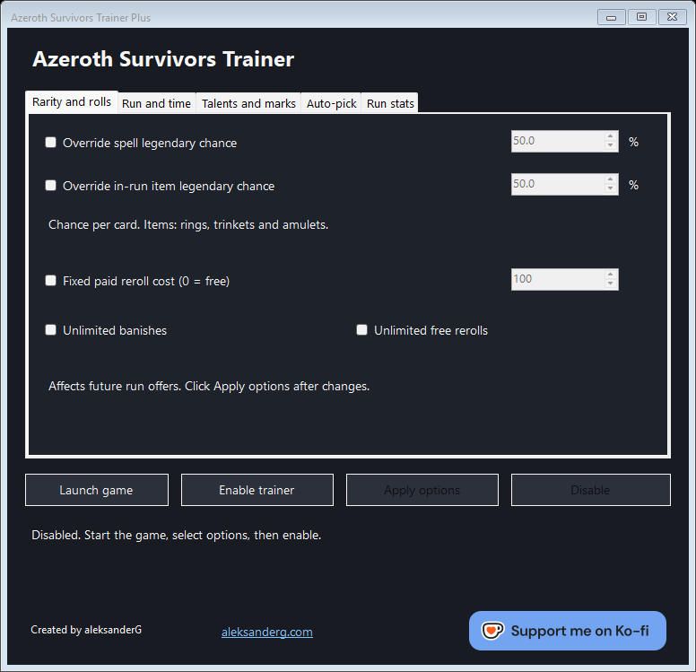
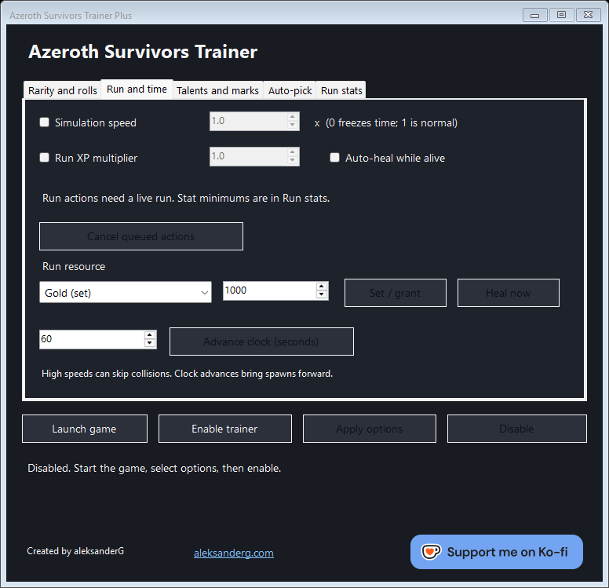
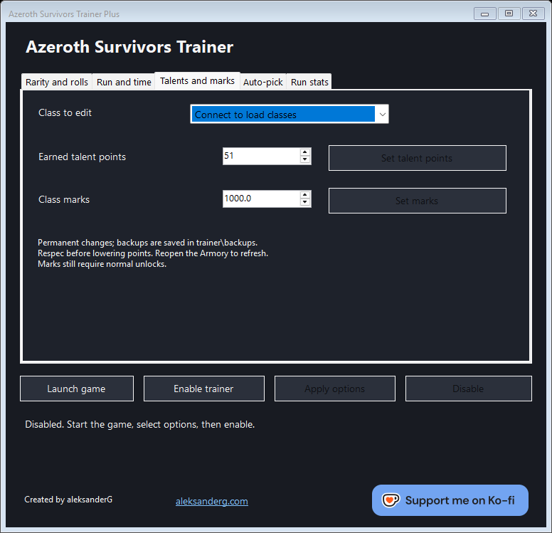
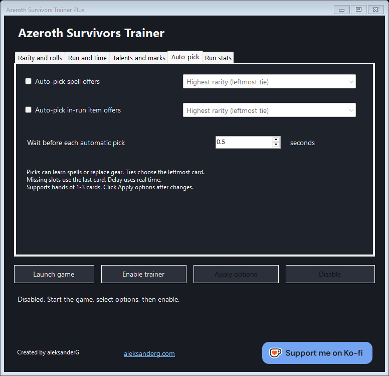
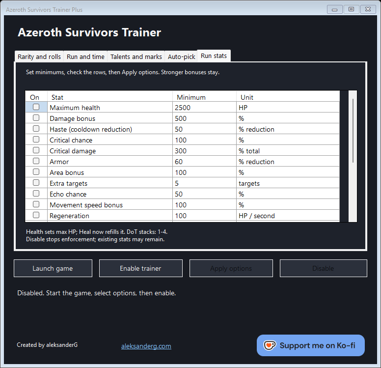

# Azeroth Survivors Trainer Plus

A portable Windows x64 trainer for Azeroth Survivors by **[aleksanderG](https://aleksanderg.com/)**. Customize your runs and class progression from five tabs. Every option starts off.

[More projects](https://aleksanderg.com/) · [Support on Ko-fi](https://ko-fi.com/K3P227JS3D)



## Features

| Tab | Functionality |
| --- | --- |
| **Rarity and rolls** | Separate spell and item legendary chances (0–100%), fixed paid reroll cost (including free), unlimited banishes, unlimited free rerolls. |
| **Run and time** | Simulation speed (0–10×), XP multiplier (0.1–100×), auto-heal, instant healing, set gold/banishes/free rerolls/shield, grant XP, advance the clock, cancel queued actions. |
| **Talents and marks** | Set earned talent points (0–51) and class marks for classes in your profile. Automatic backups before permanent edits. |
| **Auto-pick** | Separate spell and item rules: left, middle, right, random, or highest rarity. Adjustable delay (0–10 seconds). Supports hands of 1–3 cards. |
| **Run stats** | 20 individually selectable stat minimums. Stronger existing bonuses are preserved. |

**Available stats:** maximum health, damage, haste, critical chance, critical damage, armor, area, extra targets, echo chance, movement speed, regeneration, pickup radius, remaining lives, experience, gold, luck, buff power, DoT stack limit, DoT haste, and kill heal.

## Screenshots

Click an image to view it at full size.

| Run and time | Talents and marks |
| --- | --- |
| [](docs/images/run-and-time.png) | [](docs/images/talents-and-marks.png) |
| **Auto-pick** | **Run stats** |
| [](docs/images/auto-pick.png) | [](docs/images/run-stats.png) |

## Build and launch

Requires **64-bit Windows**, **.NET Framework 4.5 or newer** (4.8 recommended), and a supported desktop build of Azeroth Survivors. Run the trainer and game under the same Windows user with matching administrator privileges.

```powershell
git clone https://github.com/aleksandeerG/AzerothSurvivors-trainer.git
Set-Location .\AzerothSurvivors-trainer
powershell -NoProfile -ExecutionPolicy Bypass -File .\scripts\build.ps1
Start-Process '.\build\Azeroth Trainer Plus.exe'
```

The build uses Windows PowerShell and the C# compiler included with .NET Framework. It downloads [Iced](https://github.com/icedland/iced) on the first build. Visual Studio and the .NET SDK are not required.

The output is **`build\Azeroth Trainer Plus.exe`**, a single portable file. Run it from any writable folder. Game files are not included.

Optionally, copy the trainer to your game folder during the build:

```powershell
powershell -NoProfile -ExecutionPolicy Bypass -File .\scripts\build.ps1 -GameDirectory 'F:\Games\Azeroth Survivors'
```

## Usage

1. Start the game, or click **Launch game** and choose its folder. The trainer remembers the location.
2. Select your options and click **Enable trainer**.
3. Click **Apply options** after changing switches, values, or auto-pick rules.
4. Use the action buttons for healing, resources, time, talents, and marks. Run actions need an active run.
5. Click **Disable** or close the trainer normally when finished.

For class edits, wait for the completion message and reopen the Armory. Open a class in the Armory or play it once if it is missing from the list. Respec before reducing earned points below allocated ranks. Normal unlock requirements still apply.

**Permanent edits and completed actions are not undone by Disable.** Profile backups are saved in `trainer\backups` beside the trainer. To restore one, close the game and trainer, preserve your current save, then copy the chosen backup over the save file it came from.

## Compatibility and help

The trainer checks compatibility when connecting. Unsupported options are disabled; game updates may require a trainer update. The three reviewed desktop builds include the November 8, 2026 build.

| Issue | What to do |
| --- | --- |
| Game not found | Use **Launch game** to choose its folder, or start the game and click **Enable trainer**. Close extra game instances. |
| Access denied | Match the game's Windows user and administrator privileges. |
| Some options are unavailable | Check the status message. The installed build may need a compatibility update. |
| Partially enabled | Keep the trainer open; retry **Apply options** or use **Disable**. |
| An action stays queued | Enter an active run; use **Cancel queued actions** to discard pending run requests. |
| Trainer was forcibly closed while enabled | Restart the game before reconnecting. |

High simulation speeds can skip collisions. In co-op, joining clients cannot control the host's simulation.

For a compatibility report with the game closed, run from the repository root:

```powershell
Start-Process '.\build\Azeroth Trainer Plus.exe' -ArgumentList '--verify-files' -Wait
Get-Content .\build\trainer\game-check.txt
```

## Support

<a href="https://ko-fi.com/K3P227JS3D"></a>

Ko-fi artwork: [official brand assets](https://more.ko-fi.com/brand-assets).
